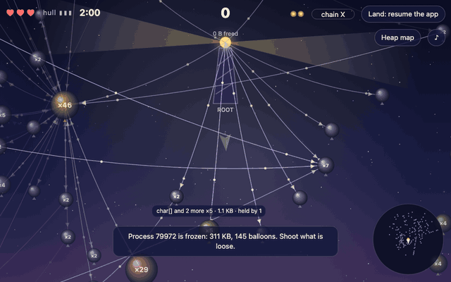

# Manual GC

A garbage collector for .NET where you do the collecting.

When an app calls `GC.Collect()`, it freezes and a web page shows you its heap. You decide what is garbage.
Get it right and the memory is really freed and used again. Hit something that is still alive and you lose a
life. When you are done, the app carries on as if nothing happened.

There are two ways to play:

* **The heap map** shows every object as a coloured block, and you drag an eraser over it.
* **Loose Balloons**, shown above, turns every object into a balloon and every reference into a rope. Anything
  you can follow back to the tower is alive. Shoot down the rest.

This is a real GC library. The stock .NET runtime loads it, with no fork and no patches. It is also a toy:
there is one heap, nothing is ever moved, and finalizers never run.

## Play

You need a Mac with Apple silicon, the .NET 10.0.14 runtime and the Xcode Command Line Tools.

    ./play samples/airfield

Give it a project folder, a `.csproj` or a built `.dll` of your own instead, if you like. To start a round
whenever the app has used 256 MB:

    ./play --limit 256 ~/code/MyWebApp

Then open http://localhost:5711/flight.html to fly, or http://localhost:5711 for the heap map, and press
**Freeze**.

Please only do this on your own machine. While you play, the app answers nobody, and because finalizers never
run, long sessions leak memory.

## What works

Web apps built for .NET 8, 9 and 10 are tested. The older two run on .NET 10. Apps that bring their own
runtime, Native AOT, x64 builds and .NET Framework do not work.

## Settings

Set these in the environment before you run `./play`:

* `MANUALGC_LOG=1` logs every collection. Use 2 to also count objects by type.
* `MANUALGC_PORT` is the port the GC uses to reach the viewer. The default is 5710.
* `MANUALGC_POISON=1` overwrites erased memory, so that bugs show up sooner.
* `MANUALGC_HARDCORE=1` lets you erase live objects from the heap map. **This crashes the app.**

The viewer takes `--WebPort`, `--GcPort`, `--Lives` and `--Seconds`.

To use the library without `./play`, set `DOTNET_GCPath` to its full path and `DOTNET_gcServer=0` for the app.
Do not set them for the viewer. Without a viewer, nothing is ever collected.

## Tests

Run any of the scripts in `tests`. Each one builds what it needs, runs real apps under this GC and checks what
happened. Some of them also drive the web pages, for which they need Node 22 and Chrome.

## More

* [How it works](docs/design.md)
* [What the GC and the viewer say to each other](docs/protocol.md)
* [Which parts of the GC interface are stubs](docs/interface.md)
